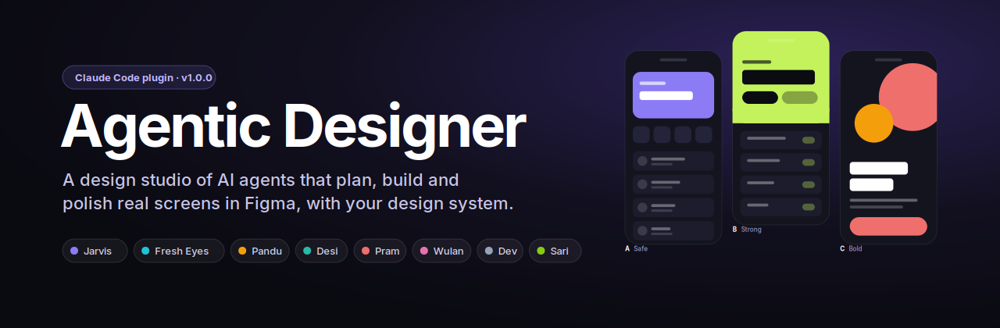
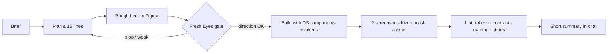

<p align="center"></p>

<p align="center">
  
  
  
  
</p>

**Agentic Designer** turns Claude Code into a small product-design studio. You brief it like a design lead; **Jarvis**, a
senior product-designer agent, plans in a few lines, builds real screens in Figma with *your* design system, looks at what it
built, polishes it, and checks it with a lint script, then a separate critic reviews it with fresh eyes.


## What it does
- **Designs and builds in Figma**: real components and tokens from your DS, any industry and visual style, phones,
  tablets, web, foldables (Fold/Flip) and dual-screen devices in portrait and landscape, with min/max-width specs for devs.
- **Explores**: `/explore` builds three genuinely different directions (safe · strong · bold), never three recolors.
- **Reviews itself honestly**: Fresh Eyes sees only screenshots, your taste file and a rubric; a pixel-diff mode checks small edits.
- **Remembers your design system**: `/add-ds` reads it once (tokens per brand × theme, sizes, fonts, component keys); after
  that agents stop re-querying Figma. `/new-brand` and `/optimize-brand` manage brand modes safely (preview → dry run → one mode).
- **Prototypes**: interactive HTML with a device viewer (phone, landscape, foldable, dual-screen) or clickable Figma flows.
- **Motion**: Figma Smart Animate, **Lottie JSON**, or a dev spec (durations, easings) from your motion tokens.
- **Writes the documents**: PRDs and change summaries in a fixed, reviewable format.
- **Keeps the canvas clean**: no notes or annotations in your files; explanations stay in chat.
- **Shows its work**: a live 3D office where you can watch the agents walk to their desks, grab skills, and hand off.

## How it works


| Agent | Role | Model |
|---|---|---|
| **Jarvis** | Lead product designer, plans, builds, polishes in Figma | Opus |
| **Fresh Eyes** | Independent visual critic (screenshots + taste + rubric only) | Sonnet |
| **Pandu** | Prototypes (HTML / Figma), motion, Lottie | Opus |
| **Desi** | Design systems, brand modes, DS change proposals | Opus |
| **Pram** | PRDs, one-pagers, research | Opus |
| **Wulan** | UX writing and localization | Sonnet |
| **Dev** | iOS / Android / web feasibility | Sonnet |
| **Sari** | Nightly learning from references and your taste | Sonnet |

<!-- Screenshots: add your own (fictional brands only) to docs/screens/ and uncomment.
<p align="center">
  
  
  
  
</p>
-->

## Quick start
Requirements: [Claude Code](https://docs.claude.com/en/docs/claude-code/overview) or Cowork (plain chat can't run subagents, files or
scripts), the **Figma MCP** connected (Full seat for editing), and Node.js 18+ (lint, office, scripts). A preflight at session start
shows the loaded version and warns if Node.js is missing.

**Option A, from GitHub (auto-updates):**
```bash
claude plugin marketplace add https://github.com/reyhan-ak-design/agentic-designer.git
claude plugin install agentic-designer@agentic-designer-marketplace --scope project
```
**Option B, Claude desktop app:** download `agentic-designer-personal-plugin-v1.1.0.zip` from Releases →
**Customize → Plugins → + → Upload plugin**.

Then, in your design workspace: `/init` → `/doctor` → `/add-ds <your Figma DS link>` (or try the built-in demo DS) → brief Jarvis.

## Commands
| Command | What it does |
|---|---|
| `/explore` | Three directions for a screen |
| `/fold`, `/responsivemobile` | Foldable / dual-screen and responsive Android + iPhone versions |
| `/prototype` · `/motion` | Prototype (HTML or Figma) · animation (Figma, Lottie, dev spec) |
| `/add-ds` · `/refresh-ds` | Store your design system once · refresh what changed |
| `/new-brand` · `/optimize-brand` | New brand mode with preview · audit a brand against the base |
| `/rename-screens` | Name screens `flow.context.state[.variant][.device]` |
| `/summary` | Change summary or PRD in the template format |
| `/taste` · `/upgrade` | Learn your taste from images · turn repeated feedback into rules |
| `/init` · `/doctor` · `/resume` | Set up · health check · continue after an interruption |
| `/agentic-designer:office` | Open the live 3D office |

## Example briefs
```
/explore Home for a crypto app "Kora", iOS 390×844, feel: confident, premium, calm. Default only.
/fold home.wallet.default, Galaxy Z Fold cover + inner, portrait and landscape
/new-brand Acme Pay
/prototype Top-up flow: pick amount, choose VA or QRIS, PIN, success/failed, HTML + foldable
```

## Quality & safety
- 121 automated checks (`node tools/test.mjs`): scripts, manifests, brand tools, prototype lint, pixel-diff, naming grammar.
- Design-system edits are dry-run first, use tested helpers (variant clones keep their property references), and are audited after every change.
- Brand tools write only to the brand collection and only to the one target mode; everything is previewed before Figma is touched.

## Credits
Made by **Reyhan Adinata Kurniawan**, product designer. three.js (MIT) is loaded from a CDN for the office.
Licensed under the [MIT License](LICENSE).
